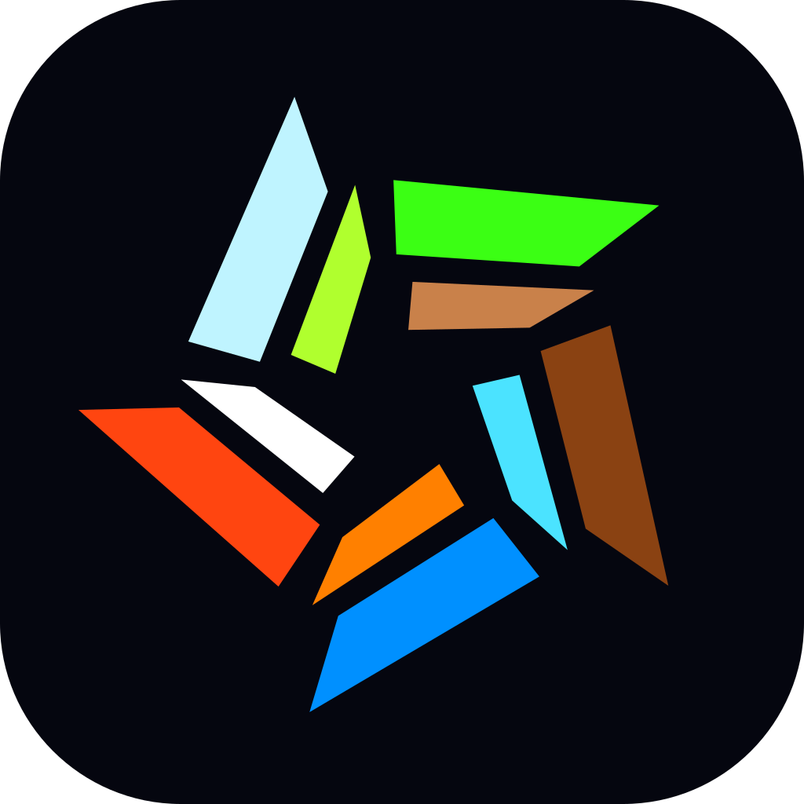

<p align="center">
  
</p>

<h1 align="center">CrashWOC: NuWorld</h1>

<p align="center">
  A native PC port of <i>Crash Bandicoot: The Wrath of Cortex</i> (PS2, PAL v1.03)
</p>

<p align="center">
  <a href="#nuworld-first-startup">First startup</a> ·
  <a href="#building">Building</a> ·
  <a href="#settings">Settings</a> ·
  <a href="https://discord.gg/kmCPpW4KvJ">Discord</a> ·
  <a href="https://github.com/denzi-gh/crashwoc-decomp-ps2">Decompilation</a>
</p>

<p align="center">
  <a href="https://github.com/denzi-gh/crashwoc-nuworld/actions/workflows/build.yml"></a>
  <a href="https://decomp.dev/denzi-gh/crashwoc-decomp-ps2"></a>
  
  <a href="LICENSE"></a>
  <a href="https://discord.gg/kmCPpW4KvJ"></a>
</p>

---

NuWorld is not an emulator. It runs the game's own code, rebuilt from the
[decompilation](https://github.com/denzi-gh/crashwoc-decomp-ps2), natively on PC. It contains no game data: you
need your own copy of the game (PAL, SLES-50386, v1.03).

> [!WARNING]
> NuWorld is **not** meant to be played yet, even though most things already work. The first release will be the
> movement beta. Issues and pull requests are closed until then.

## What it adds

- 50 or 60 Hz, any aspect ratio, frame interpolation
- Window, fullscreen and borderless, resolution scale, MSAA
- Remappable gamepad and keyboard, rumble, button prompts
- Readable saves, import of PS2 and PCSX2 saves

## NuWorld first startup

On the first start NuWorld asks for your disc image (`.iso`, or `.bin`/`.cue`), checks it and imports it.

> [!IMPORTANT]
> For now the game starts with `--boot`:
>
> ```sh
> ./build/release/crashwoc-nuworld --boot
> ```

## Building

Needs Clang, CMake 3.25+, Ninja and Python 3.11+ (`python -m pip install -r tools/requirements.txt`). On Windows,
use an MSYS2 CLANG64 shell.

```sh
git clone --recursive https://github.com/denzi-gh/crashwoc-nuworld.git
cd crashwoc-nuworld
cmake --preset release
cmake --build --preset release
```

## Settings

| Key | |
|---|---|
| F1 | Menu: video, audio, controls, game speed |
| F2 | Crash's movement |
| F11 | Fullscreen |
| F12 | Screenshot |

> [!NOTE]
> The settings menu is a debug menu. A proper in-game menu comes with the first release.

## Discord

Updates on NuWorld are posted on [Discord](https://discord.gg/kmCPpW4KvJ).

## Credits

[Kenney](https://kenney.nl) Input Prompts (CC0), Atkinson Hyperlegible (SIL OFL), [SDL3](https://libsdl.org),
[Dear ImGui](https://github.com/ocornut/imgui), and the SPU2 interpolation table from [PCSX2](https://pcsx2.net).

NuWorld is a fan project and not affiliated with Activision or Traveller's Tales.

## License

GPL-3.0, see [LICENSE](LICENSE).
